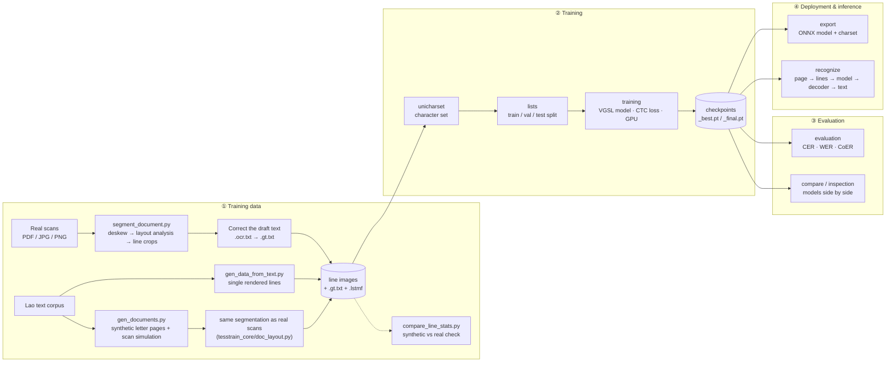

# Lao OCR Toolkit

**Build training data, train and evaluate OCR models for Lao — on GPU with PyTorch**

This toolkit covers the whole path to a Lao text-line recognizer:

- **Data**: turn real scanned documents into line images, and generate synthetic Lao lines and whole synthetic documents that look like real scans.
- **Training**: train Tesseract-style LSTM models (described by a VGSL string) on GPU with PyTorch and CTC loss, instead of Tesseract's CPU-only `lstmtraining`.
- **Evaluation**: CER, WER and Lao-specific error analysis (tone marks, vowels, consonants), plus comparisons against Tesseract models.
- **Deployment**: export to ONNX.

It reads the same ground-truth format as [tesstrain](https://github.com/tesseract-ocr/tesstrain) (`.gt.txt`, `.lstmf`, `unicharset`), so existing Tesseract training data works unchanged. Trained models are exported to ONNX, not to Tesseract `.traineddata`.

[](https://www.python.org/downloads/)
[](https://pytorch.org/)
[](LICENSE)

---

## ✨ Features

| Feature | Description |
|---------|-------------|
| **GPU Training** | 10–50× faster than Tesseract's `lstmtraining` |
| **PyTorch LSTM** | Standard PyTorch nn.LSTM with CTC loss |
| **Optimizers** | Adam and SGD + Momentum supported |
| **VGSL Architectures** | Tesseract VGSL strings plus PyTorch-only layers: BatchNorm, Dropout, Dense, attention height-collapse (`Atys`, `Matys`, `Hybys`), self-attention and Conformer blocks |
| **Tesseract Transfer** | Warm-start from a Tesseract `.traineddata` / `.lstm` model |
| **Beam Search + DAWG** | Dictionary-constrained decoding with word/number/punctuation DAWGs |
| **Language Model** | N-gram LM (char trigrams + word bigrams) for beam search |
| **Page Segmentation** | PSM 3, 6, 7, 13 for full-page and single-line OCR |
| **ONNX Export** | Cross-platform deployment with ONNX Runtime |
| **Synthetic Data** | Generate training images with GPU-accelerated augmentations + calibrated presets |
| **Real-World Calibration** | Enrich the corpus from real ground truth and check the synthetic-vs-real gap with KL divergence |
| **Lao Error Analysis** | Component Error Rate (CoER) per Lao character group: tones, upper/lower vowels, consonants… |
| **Character Analytics** | Analyze character frequencies, Unicode codepoints, and categories |

---

## 📑 Table of Contents
- [✨ Features](#-features)
- [📦 Installation](#-installation)
- [🚀 Quick Start (5 minutes)](#-quick-start-5-minutes)
- [📝 Synthetic Data Generation](#-synthetic-data-generation)
  - [Augmentation Presets](#augmentation-presets---preset)
  - [Real-World Calibration Workflow](#real-world-calibration-workflow)
  - [Document-Level Synthesis](#document-level-synthesis-closest-to-real-scans)
- [📖 Detailed Usage](#-detailed-usage)
  - [Training](#training)
  - [Evaluation](#evaluation)
  - [Recognition (Inference)](#recognition-inference)
  - [Export](#export)
- [📁 Project Structure](#-project-structure)
- [🏗️ Pipeline Architecture](#️-pipeline-architecture)
- [🔧 Advanced Features](#-advanced-features)
- [⚡ Performance](#-performance)
- [🆚 Comparison with Tesseract](#-comparison-with-tesseract)
- [📊 Evaluation & Analysis Tools](#-evaluation--analysis-tools)
  - [tesseract_tools.py — Training Plots, Model Comparison & Timing](#tesseract_toolspy)
  - [tesstrain_core/compare.py — PyTorch Model Comparison](#tesstrain_corecomparepy)
  - [experiments/compare_cross.py — Original vs Fine-tuned Cross-Comparison](#experimentscompare_crosspy)
- [🐛 Troubleshooting](#-troubleshooting)
- [📄 Command Reference](#-command-reference)
- [🛠️ Utilities](#️-utilities)
- [⚠️ Known Limitations](#️-known-limitations)
- [🧪 Development](#-development)

---

## 📦 Installation

### 1. Clone

```bash
git clone https://github.com/Monaliza14xx/Lao_OCR_Toolkit.git
cd Lao_OCR_Toolkit
```

### 2. Install dependencies

```bash
# Core requirements
pip install -r requirements.txt

# For GPU training (choose your CUDA version):

# CUDA 11.8
pip install torch --index-url https://download.pytorch.org/whl/cu118

# CUDA 12.1
pip install torch --index-url https://download.pytorch.org/whl/cu121

# CPU only (no GPU)
pip install torch --index-url https://download.pytorch.org/whl/cpu
```

### 3. Optional dependencies

```bash
# ONNX export & inference
pip install onnx onnxruntime       # CPU
pip install onnx onnxruntime-gpu   # GPU

# Training charts and live metrics
pip install matplotlib tensorboard

# Glyph-coverage checks in the synthetic data generator (recommended)
pip install fonttools

# Document workflow: line segmentation (scipy) and reading PDFs (pypdfium2)
pip install scipy pypdfium2

# Comparing against real Tesseract models (also needs the tesseract binary in PATH)
pip install pytesseract
```

### 4. Verify installation

```bash
python3 -c "import torch; print(f'PyTorch {torch.__version__}, CUDA: {torch.cuda.is_available()}')"
```

### Google Colab (zero-install)

```python
# Everything is pre-installed on Colab!
!git clone https://github.com/Monaliza14xx/Lao_OCR_Toolkit.git
%cd Lao_OCR_Toolkit

# Verify GPU
import torch
print(f"GPU: {torch.cuda.get_device_name(0)}")  # Tesla T4

# Start training
!python3 torch_train.py training --model_name lao --max_iterations 5000
```

---

## 🚀 Quick Start (5 minutes)

### Step 1: Prepare ground truth

There are three main ways to get training data:

#### Way 1: Real documents (Highest Accuracy)
Manually crop lines from real scanned documents and transcribe them.
Place your images (`.tif`/`.png`) and transcriptions (`.gt.txt`) in `data/<model_name>-ground-truth/`:
```
data/lao-ground-truth/
  ├── line_001.tif       # Grayscale line image
  ├── line_001.gt.txt    # Text file containing exactly: "ສະບາຍດີ"
```

#### Way 2: Synthetic generation from your own text (Fastest)
Render images directly from a plain text corpus using the included script. This is the fastest way to bootstrap a new language or fine-tune an existing model on your specific domain's vocabulary.
```bash
python3 gen_data_from_text.py \
    --corpus corpus.txt \
    --output_dir data/lao-ground-truth \
    --font fonts/Phetsarath-Regular.ttf fonts/saysettha_ot.ttf \
    --count 10000 \
    --preset scan-mild \
    --to_lstmf
```
*(See the [Synthetic Data Generation](#-synthetic-data-generation) section for advanced options like multi-font, noise, and blur.)*

#### Way 3: Migrate from original Tesseract training
If you already have a `data/<model_name>-ground-truth/` folder containing `.tif` and `.gt.txt` pairs from using the original `tesstrain` Makefile, you can reuse it entirely without any changes!

### Step 2: Run the full pipeline

```bash
# 1. Build character set
python3 torch_train.py unicharset --model_name lao

# 2. Create file lists  (80% train / 10% val / 10% test)
python3 torch_train.py lists --model_name lao --ratio 80 10 10

# 3. Train on GPU
python3 torch_train.py training --model_name lao \
    --max_iterations 10000 --target_error_rate 0.01

# 4. Export for deployment
python3 torch_train.py export --model_name lao
```

That's it! Your model is ready at `data/lao/lao.onnx`.

---

## 📝 Synthetic Data Generation

You can generate training samples by rendering text using `gen_data_from_text.py`. Supports **two processing modes**:

| Mode | Flag | Best for | How it works |
|------|------|----------|-------------|
| **CPU** | `--device cpu` | Small datasets, many cores | Multiprocessing with `--workers` |
| **GPU** | `--device cuda` | Large datasets (50k+) | Batched augmentations on GPU with `--batch_size` |

**Example 1: GPU mode with `--preset` (recommended)**
```bash
python3 gen_data_from_text.py \
    --corpus /path/to/lao_corpus.txt \
    --output_dir data/lao-synth-ground-truth \
    --font font1.ttf font2.ttf font3.ttf \
    --count 50000 \
    --preset real-match \
    --font_size_min 28 --font_size_max 72 \
    --device cuda --batch_size 256 \
    --ext jpg --to_lstmf
```

**Example 2: GPU mode (manual augmentation params)**
```bash
python3 gen_data_from_text.py \
    --corpus /path/to/lao_corpus.txt \
    --output_dir data/lao-synth-ground-truth \
    --font font1.ttf font2.ttf font3.ttf \
    --count 140000 \
    --noise 0.3 --blur 0.3 --augment 0.5 \
    --font_size_min 28 --font_size_max 48 \
    --device cuda --batch_size 256 \
    --ext png --to_lstmf
```

**Example 3: CPU mode (alternative)**
```bash
python3 gen_data_from_text.py \
    --corpus /path/to/lao_corpus.txt \
    --output_dir data/lao-synth-ground-truth \
    --font /path/to/NotoSansLao.ttf \
    --count 10000 \
    --device cpu --workers 8 \
    --to_lstmf
```

**Example 4: Convert existing images to `.lstmf`**
```bash
python3 gen_data_from_text.py --convert_only --ext png \
    --output_dir data/lao140k-ground-truth
```

#### How it works:
1. **Label normalization**: each corpus line is put into standard Lao storage order (see below).
2. **Text rendering** (CPU): each line is drawn with a random font and size. Lao runs use the `--font` fonts; digits, Latin and punctuation use `--sec_font` (Times-style fonts passed via `--font` are moved there automatically). All runs share one baseline.
3. **Augmentation** (CPU or GPU): noise, blur, contrast, erosion, perspective, and with `--preset` also paper texture, uneven lighting, coloured ink, JPEG artifacts, scan noise and skew.
4. **Output**: `.tif`/`.png`/`.jpg` + `.gt.txt` + optional `.lstmf`.

#### Lao text handling

| What | Why it matters for OCR training |
|------|------|
| **Standard character order.** Inside a cluster: consonant, ຼ, vowel marks (incl. ໍ), tone marks, then ຳ. So ນ້ຳ is stored as ນ + ້ + ຳ; ໍ + າ typed separately becomes ຳ; NFC; zero-width characters removed. | Labels match how real typed ground truth encodes the same words. |
| **HarfBuzz shaping** (Pillow with libraqm) for fonts that pass a quick test with stacked marks (ຂຶ້ນ, ເຂົ້າ, ນ້ຳ…). | Tone marks sit above upper vowels and spacing is natural, as in printed documents. |
| **Fallback renderer** for fonts whose HarfBuzz output is broken (e.g. `phetsarath_ot.ttf`) or when libraqm is missing. It draws one cluster at a time and pulls runaway marks back over their base. | Those fonts can still be used safely. The generator prints which renderer each font gets. |
| **Fixed line box.** Images are cropped vertically to the font's ascent/descent (with random margins), not to the ink. | Text stays the same size after the trainer rescales lines to a fixed height, whether or not a line has upper/lower marks. |
| **No mismatched labels.** With `fonttools` installed, a font missing any glyph of a line isn't used for it; lines no font can draw are dropped at startup; a line that would draw nothing for a character is re-rendered with another font. The canvas always fits the whole line. | Every image shows exactly its `.gt.txt`. |
| **Per-sample random seed** (`--seed` + sample index). | Runs are reproducible and parallel workers don't repeat each other's choices. |

#### Output Example:
- `line_0001.png`: A 48px high image containing the text.
- `line_0001.gt.txt`: A text file containing exactly what is in the image.

---

### Augmentation Presets (`--preset`)

The `--preset` flag applies a named bundle of augmentation parameters calibrated for different use cases. Using a preset **overrides** the manual `--noise`/`--blur`/`--augment` flags and also enables the advanced real-world augmentation functions not available in manual mode.

| Preset | Description | Use When |
|--------|-------------|----------|
| `clean` | No augmentation — pure synthetic render | Ablation / baseline comparison |
| `scan-mild` | Light scan degradation | Good-quality scanned documents |
| `scan-heavy` | Heavy degradation: high noise, blur, JPEG | Aged or low-quality scans |
| `real-match` | **Calibrated from real document analysis** | Target documents similar to Lao administrative scans (values below) |

```bash
# Baseline (no augmentation)
python3 gen_data_from_text.py --corpus corpus.txt --output_dir data/out \
    --font font.ttf --count 10000 --preset clean

# Calibrated to real Lao administrative documents (Phase 1 measurements)
python3 gen_data_from_text.py --corpus corpus.txt --output_dir data/out \
    --font font.ttf --count 50000 --preset real-match --device cuda --batch_size 256
```

#### Preset Parameter Reference

Each preset controls the same set of parameters. Below is the full breakdown showing exactly what each preset sets:

| Parameter | `clean` | `scan-mild` | `scan-heavy` | `real-match` | What it controls |
|-----------|---------|-------------|--------------|--------------|------------------|
| `noise_prob` | 0.0 | 0.50 | 0.85 | **0.70** | Probability a sample receives noise |
| `noise_intensity` | 0.0 | 0.025 | 0.070 | **0.046** | Noise σ as fraction of 255 (σ = value × 255) |
| `blur_prob` | 0.0 | 0.20 | 0.60 | **0.20** | Probability a sample gets blurred |
| `blur_radius` | 0.0 | 0.50 | 1.50 | **0.0** | Gaussian blur kernel radius |
| `augment_prob` | 0.0 | 0.40 | 0.70 | **0.60** | Probability of geometric transforms (rotation, scale, perspective) |
| `brightness_max` | 0.0 | 10.0 | 30.0 | **7.7** | Max brightness shift in pixel units (±) |
| `contrast_max` | 0.0 | 0.10 | 0.35 | **0.138** | Max contrast scale factor (±) |
| `morph_prob` | 0.0 | 0.15 | 0.40 | **0.30** | Erosion/dilation probability |
| `rotation_max_angle` | 0° | 2.0° | 5.0° | **3.96°** | Max random rotation angle (±) |
| `jpeg_quality_range` | — | 80–92 | 50–75 | **65–90** | JPEG re-encode quality range (lower = more artifacts) |
| `paper_texture_prob` | 0.0 | 0.40 | 0.70 | **0.50** | Probability of applying paper grain texture |
| `bg_mean` | 255 | 250 | 240 | **252.8** | Target background pixel mean (real paper vs pure white) |
| `bg_std` | 0.0 | 4.0 | 12.0 | **6.4** | Background pixel std (controls grain intensity) |
| `uneven_illumination_prob` | 0.0 | 0.20 | 0.50 | **0.30** | Probability of scanner light-falloff gradient |
| `colored_ink_prob` | 0.0 | 0.01 | 0.03 | **0.02** | Probability of converting ink to a non-black color |

> Skew is capped so a line's vertical drift never exceeds its own height; otherwise long lines would turn into mostly empty space once rescaled.

> **`real-match` design rationale:** Every value is derived from measurements on 50 real Lao administrative document lines:
> - `noise_intensity = 0.046` ← measured noise σ = 11.75 / 255
> - `blur_radius = 0.0` ← all 50 real images classified as **sharp** (Laplacian variance > 500)
> - `brightness_max = 7.7`, `contrast_max = 0.138` ← calibrated from Michelson contrast gap (real: 0.773 vs synthetic: 0.85)
> - `bg_mean = 252.8`, `bg_std = 6.4` ← measured from real paper background regions
> - `rotation_max_angle = 3.96°` ← 1.5× the observed skew range (±1.97°) for slight over-coverage
> - `colored_ink_prob = 0.02` ← 1/50 real lines had red ink

#### Augmentation Execution Order

Each preset runs augmentations in this fixed order (later steps depend on earlier ones):

```
1. Base augmentation  →  noise + blur + brightness/contrast + morph (CPU or GPU)
2. Paper texture      →  add_real_paper_texture()     (shifts background toward real paper mean)
3. Illumination       →  add_uneven_illumination()    (gradient overlay simulating scanner falloff)
4. Colored ink        →  add_colored_ink()            (replaces black ink with red/blue/dark-green)
5. JPEG artifacts     →  add_jpeg_artifacts()         (re-encode at random quality; applied 50% of the time)
6. Scan noise         →  add_scan_noise_profile()     (correlated sensor noise on top of JPEG)
7. Rotation           →  random_rotation()            (applied last so fill colour matches background)
```

#### Real-World Augmentation Functions

| Function | Preset(s) | Key Parameters | Simulates |
|----------|-----------|----------------|-----------|
| `add_jpeg_artifacts` | `scan-mild`, `scan-heavy`, `real-match` | `quality_range=(65,90)` | Scan JPEG compression: blocking, ringing, chroma artefacts |
| `add_uneven_illumination` | `scan-mild`, `scan-heavy`, `real-match` | `max_gradient=0.12` (12% brightness swing) | Scanner light falloff; edges darker/lighter than centre |
| `add_colored_ink` | `scan-mild`, `scan-heavy`, `real-match` | colors: `red`, `dark-red`, `blue` | Colored stamp ink, official document header color lines |
| `add_real_paper_texture` | `scan-mild`, `scan-heavy`, `real-match` | `bg_mean=252.8`, `bg_std=6.4` | Real paper grain (multi-scale Perlin) vs flat white (255) |
| `add_scan_noise_profile` | `scan-mild`, `scan-heavy`, `real-match` | `noise_sigma=σ`, 70% Gaussian + 30% correlated | Scanner sensor noise (row/column drift + pixel noise) |

#### Manual Augmentation Options

> Use these when you want fine-grained control without a preset.

| Option | Default | Description | Effect on Model |
|--------|---------|-------------|-----------------|
| `--noise` | 0.0 | Gaussian noise probability (0.0–1.0) | Robustness to scanned/faxed docs |
| `--noise_intensity` | 0.04 | Noise σ as fraction of 255 | Controls noise strength |
| `--blur` | 0.0 | Gaussian blur probability (0.0–1.0) | Out-of-focus camera robustness |
| `--blur_radius` | 0.9 | Blur kernel radius | Controls blur strength |
| `--augment` | 0.0 | Geometric augmentation probability | Skew, scale, perspective robustness |
| `--brightness_max` | 20.0 | Max brightness shift (pixel units ±) | Exposure variation |
| `--contrast_max` | 0.2 | Max contrast scale factor (±) | Contrast variation |
| `--morph_prob` | 0.15 | Erosion/dilation probability | Over/under-inked print simulation |
| `--font_size_min` | 28 | Minimum font size in pt | — |
| `--font_size_max` | 48 | Maximum font size in pt | Size diversity |

> **Tip:** Use `--font_size_min 28 --font_size_max 72` to cover header (large), body (medium), and label (small) line types found in real documents.

---

### Real-World Calibration Workflow

If you have a set of real scanned document line images (`.jpg` + `.gt.txt` pairs), you can use them to make the synthetic data look more like your target documents.

#### Step 1 — Profile your real documents

The profiling script used to measure the real documents is **not included** in this repository. Its measurements (noise σ, background mean/std, contrast, skew) are already built into `--preset real-match`, so you can start at Step 2. If you profile your own documents, put the values in a new entry of `_AUGMENTATION_PRESETS` in `gen_data_from_text.py`.

#### Step 2 — Enrich your training corpus

```bash
python3 experiments/build_augmented_corpus.py \
    --real_gt /path/to/your-real-documents \
    --base_corpus data/lao-corpus.txt \
    --output data/lao-corpus-enriched.txt \
    --n_oversample 5
```

- Merges real-world GT text into your base corpus
- Detects under-represented characters → oversamples lines containing them
- Outputs a `.meta.txt` file with per-character coverage report

#### Step 3 — Generate calibrated training data

```bash
python3 gen_data_from_text.py \
    --corpus data/lao-corpus-enriched.txt \
    --output_dir data/lao-augmented-v2 \
    --font fonts/Phetsarath-Regular.ttf \
           fonts/Phetsarath-Bold.ttf \
           fonts/phetsarath_ot.ttf \
    --font_size_min 28 --font_size_max 72 \
    --count 50000 \
    --preset real-match \
    --device cuda --batch_size 256 --ext jpg --to_lstmf
```

#### Step 4 — Validate the domain gap is closed

```bash
python3 experiments/validate_augmentation.py \
    --real_dir /path/to/your-real-documents \
    --synth_dir data/lao-augmented-v2 \
    --n_synth_sample 500
```

`--analysis_params path/to/augmentation_params.json` is optional; pass it only if you have your own profiling output.

Outputs `data/lao-augmented-v2/validation/`:
- `validation_report.md` — KL divergence scores (target: all < 0.5) with pass/fail grade
- `comparison_gallery/` — side-by-side real vs. synthetic image pairs
- `kl_divergence.json` — machine-readable scores for CI integration

> **Recommended threshold:** KL divergence < 0.15 (🟢 Good) for background, contrast, and noise. Values > 0.5 indicate a significant remaining domain gap.


---

### Document-Level Synthesis (closest to real scans)

Line-by-line rendering (`gen_data_from_text.py`) gives clean, tightly cropped lines. Real OCR input is different: lines are cut out of scanned pages by a segmenter, so they carry the segmenter's habits (margins, leftover skew, slivers of neighbouring lines, stamps and signatures overlapping text) and they are mostly long lines. The document workflow reproduces that by sending **real scans and synthetic pages through the same layout analysis and line cropping**.

```
real scans (PDF/JPG) ──► segment_document.py ──► real line crops + Tesseract draft text
                              │  (deskew → layout analysis → line crops)
synthetic pages ─────► gen_documents.py ──────► synthetic line crops + exact labels
  (doc_synth: letter layout + scan simulation)
                              ▼
                    compare_line_stats.py  (is the synthetic data close to the real crops?)
```

#### Step 1 — Segment real documents into lines

```bash
python3 segment_document.py --input scans/ --output_dir data/real-lines
```

For each document: the straightened page, a layout preview (`page1_layout.png`: green = text lines in reading order, red = emblem/stamp/signature, blue = ruled lines), one image per line, and Tesseract's draft text in `*.ocr.txt`. Correct a draft and save it as `*.gt.txt` to turn the line into real ground truth.

How the segmentation works (`tesstrain_core/doc_layout.py`):
1. **Deskew** the page (projection-profile search, ±4°).
2. **Connected components**, classified against the page's typical letter-body height: letters, marks (vowel/tone marks, dots), graphics (taller than 3 letter bodies), rules (long and thin).
3. **Lines**: letters that overlap vertically and sit close together are chained; a wide gap starts a new line (left-aligned name vs right-aligned number on the same row).
4. **Lao marks** join the nearest line above or below, whole — a stacked vowel + tone above a line reaches further than a mark below one, so they are never cut off or given to the wrong line.
5. **Graphics** are excluded: dense big components (emblem) and clusters of red/blue ink (stamps, signatures). Red or blue *text* lines (a name, a stamped number) stay, and sparse frames (table grids) don't swallow the text inside them.

#### Step 2 — Generate synthetic documents

```bash
python3 gen_documents.py --corpus data/lao-corpus.txt --output_dir data/lao-docs \
    --font fonts/Phetsarath-Regular.ttf fonts/Phetsarath-Bold.ttf fonts/saysettha_ot.ttf \
    --sec_font fonts/TimesNewerRoman-*.otf --count 2000 --workers 8 --to_lstmf
```

Each page is an A4 letter laid out like a Lao ministry letter, with random variation: emblem, national motto, ministry/department block, document number (sometimes stamped in red) and place/date (sometimes a handwritten blue day), bold title, `ເຖິງ:` / `ເລື່ອງ:` blocks with hanging indents, `- ອີງຕາມ` references, justified body paragraphs mixing Lao with Latin, digits, Lao digits, dates, times, phone numbers, e-mails and URLs (sometimes underlined), bold words, optional tables, a signature block with a round stamp and a pen signature overlapping the text, and a ruled footer.

The page is then "scanned": skew, print blur, paper tint, uneven lighting, resolution loss, sensor noise, specks, optional photocopy look and JPEG. It is straightened and segmented by the **same code as step 1**, and each line crop is labelled with the words that lie completely inside it. Crops that cut through a word or contain no text are discarded, so labels are exact. `summary.json` reports how many lines were kept and dropped; `pages/` keeps the first pages with their layout previews.

Defaults are calibrated on a real 300 dpi scan of a Lao ministry letter: body ≈ 12.4 pt, line pitch ≈ 1.35 × font size, margins ≈ 3.2 cm / 1.6 cm, page skew ≈ 1°, gray ink, clean white paper, JPEG, red stamp ≈ 7 % and blue pen ≈ 2.5 % of the ink. Use a corpus of real Lao sentences (phrases separated by spaces) so word spacing matches real text.

Fonts whose HarfBuzz output is broken (e.g. `phetsarath_ot.ttf`) are skipped for whole pages; `Phetsarath-Regular.ttf` has the same design.

#### Step 3 — Check the domain gap

```bash
python3 compare_line_stats.py --real data/real-lines --synthetic data/lao-docs data/lao-synth-ground-truth
```

| Property (p10 / median / p90) | Real letter | `gen_documents.py` | `gen_data_from_text.py` |
|---|---|---|---|
| Letter-body share of crop height | 0.35 / 0.42 / 0.56 | 0.33 / 0.38 / 0.49 | 0.25 / 0.33 / 0.44 |
| Line length (width ÷ height) | 2.3 / 12.8 / 25.2 | 2.4 / 13.7 / 23.5 | 1.7 / 3.5 / 10.8 |
| Paper level | 252 / 253 / 254 | 244 / 248 / 253 | 214 / 255 / 255 |
| Ink level | 35 / 40 / 67 | 17 / 42 / 79 | 2 / 40 / 111 |

*(Measured on one real document — add more real scans to calibrate more broadly.)*

> **Privacy:** scanned letters contain names, signatures and phone numbers. Keep real crops in `data/` (git-ignored) and never publish them.


---

## 📖 Detailed Usage

### File Lists

```bash
# 3-way split: 80% train / 10% val / 10% test
python3 torch_train.py lists --model_name lao --ratio 80 10 10

# 2-way split: 90% train / 10% val
python3 torch_train.py lists --model_name lao --ratio 90 10

# Legacy: use a float fraction (default 0.90 train)
python3 torch_train.py lists --model_name lao --ratio_train 0.90
```

Output files created in `data/<model_name>/`:

| File | Purpose |
|------|---------|
| `list.train` | Paths to training `.lstmf` files |
| `list.val` | Paths to validation `.lstmf` files |
| `list.test` | Paths to test `.lstmf` files *(only with 3-way split)* |

### Training

```bash
python3 torch_train.py training --model_name lao \
    --net_spec "[1,48,0,1 Ct3,3,16 Mp3,3 Lfys64 Lfx96 Lrx96 Lfx512 O1c###]" \
    --optimizer Adam \
    --learning_rate 0.002 \
    --batch_size 64 \
    --max_iterations 10000 \
    --target_error_rate 0.01 \
    --debug_interval 100
```

#### Key parameters

| Parameter | Default | Description |
|-----------|---------|-------------|
| `--model_name` | `foo` | Name for the model (e.g., `lao`, `eng`); sets the `data/<model_name>/` output folder |
| `--net_spec` | `[1,48,0,1 Ct3,3,16 Mp3,3 Lfys64 Lfx96 Lrx96 Lfx384 O1c###]` | Network architecture in VGSL format |
| `--optimizer` | `Adam` | Optimizer choice (`Adam` or `SGD`) |
| `--learning_rate` | `0.002` | Learning rate |
| `--momentum` | `0.9` | Momentum value (if `--optimizer SGD`) |
| `--weight_decay` | `0.0` | Weight decay / L2 penalty |
| `--batch_size` | `64` | Training batch size |
| `--max_iterations` | `10000` | Maximum training steps |
| `--epochs` | `0` (off) | Train for N epochs (overrides `--max_iterations`) |
| `--target_error_rate` | `0.01` | Stop early when CER reaches this value |
| `--debug_interval` | `100` | Print metrics every N iterations |
| `--start_model` | — | Path to checkpoint for fine-tuning |
| `--start_tess_model` | — | Path to Tesseract `.traineddata` or `.lstm` for transfer-learning warm-start |
| `--data_dir` | `data` | Root data directory |
| `--tensorboard` | `True` | Log live metrics to TensorBoard |
| `--tensorboard_dir` | `data/.../tensorboard` | Custom TensorBoard log directory |

#### Live Tracking & Visualizations

**TensorBoard (Live)**
Training metrics (Loss, CER, WER, Learning Rate) are automatically logged to a TensorBoard directory (`data/<model>/tensorboard/`) in real time.
```bash
# In a new terminal, start the TensorBoard server:
tensorboard --logdir data/lao/tensorboard
```
Open your browser to `http://localhost:6006` to watch your model learn.

**Training Plots (Static)**
At the end of training, a `training_plot.png` chart is automatically generated in your model directory showing Loss, CER, WER, execution speeds, and character frequencies over time. You can also manually generate this at any time:
```bash
python3 torch_train.py plot --model_name lao
```

#### Training output

Every `--debug_interval` iterations the trainer prints a report like this (this one is from an iteration where validation ran):

```
━━ iter 500/10,000 (5.0%) · epoch 2 · 312 lines/s · elapsed 2m40s · ETA 50m40s ━━
              loss      CER      WER   line acc
  train     2.1456   45.21%   78.34%     12.50%   (avg loss 2.3102, 1 batch)
  eval      2.4012   48.10%   80.20%     10.94%   ★ best so far
  CoER     tone 12.4% · upper 8.1% · lower 3.0% · front 1.2% · rear 2.1%
           cons 5.2% · special 0.0% · Lao num 10.0% · digit 2.0% · space 3.5%
           sym 4.0%
           worst: tone marks
  model    weight RMS 0.0435 · lr 1e-04 · GPU 2.10 GB (peak 3.80 GB)
  samples  [1] ✗ CER 3.0%
             GT   ສາທາລະນະລັດ ປະຊາທິປະໄຕ ປະຊາຊົນລາວ
             Pred ສາທາລະນະລັດ ປະຊາ⟦ທິ→ທີ⟧ປະໄຕ ປະຊາຊົນລາວ
           [2] ✓ exact
             GT   ສັນຕິພາບ ເອກະລາດ
           [3] ✗ CER 16.7%
             GT   ກະຊວງສຶກສາທິການ ແລະ ກິລາ
             Pred ກະຊວງສຶກສາທິການ ⟦−ແລະ ⟧ກິລາ
──────────────────────────────────────────────────────────────────────────────
```

| Row | Meaning |
|-----|---------|
| `train` | Loss, CER, WER and line accuracy (exact-match lines) on the batch just trained, so it's noisy |
| `eval` | The same on the validation list. Runs every 5 × `--debug_interval` steps; ★ marks a new best, which is saved as `<model>_best.pt` (train CER is used instead when there is no validation list) |
| `CoER` | Component error rate per Lao character class: tone marks, upper / lower / front / rear vowels, consonants, special (ຼ), Lao and Arabic digits, Latin letters, spaces, symbols ([full list](metrics.md)). Shown as `CoER*` between eval runs, when it comes from the training batch only |
| `model` | RMS of all weights, current learning rate, GPU memory |
| `samples` | Three training lines. Differences are marked `⟦GT→Pred⟧` (wrong), `⟦−GT⟧` (missing) and `⟦+Pred⟧` (extra) |

Everything is also written to `data/<model>/training.log` (CSV, including `coer_<class>` columns) and to TensorBoard (`CoER/<class>` for eval).

### Evaluation

```bash
python3 torch_train.py evaluation --model_name lao --batch_size 32
```

> **Note:** The architecture is automatically read from the checkpoint, so evaluation always works even if the checkpoint was trained with a custom `--net_spec`.
>
> **Tip:** Use `--batch_size 1` when you need results that don't depend on batch composition (see [Known Limitations](#️-known-limitations)). Evaluation always uses greedy decoding.

### Recognition (Inference)

```bash
# Single line (greedy decode)
python3 torch_train.py recognize --model_name lao --image line.png

# Full page with beam search + dictionary
python3 torch_train.py recognize --model_name lao --image page.png \
    --psm 3 --beam_width 10 --wordlist wordlist.txt

# With language model
python3 torch_train.py recognize --model_name lao --image page.png \
    --psm 3 --beam_width 10 \
    --lm_corpus data/lao-ground-truth --lm_weight 0.5
```

#### Page Segmentation Modes (PSM)

| PSM | Mode | Description |
|-----|------|-------------|
| `3` | Auto | Detect text blocks and lines automatically |
| `6` | Block | Assume single uniform text block |
| `7` | Line | Treat as a single text line |
| `13` | Raw | Single character or raw line |

### Feature Map Inspection

To visually debug what the neural network is "seeing" inside its convolutional and LSTM layers:

```bash
python3 torch_train.py inspection --model_name lao --num_samples 10
```

This exports activation maps for 10 random images from your `list.val` set to `data/lao/inspection/`. For each layer (Conv2d, MaxPool2d, etc.), it saves the outputs as grayscale PNGs so you can inspect how characters and diacritics are being processed.

### Compare Models

You can overlay the training logs of multiple models to directly compare their Validation Loss and CER curves. Additionally, if you provide a `--custom_img_dir`, it will test all models on the `.gt.txt` and image pairs found in that custom dataset.

```bash
python3 torch_train.py compare --models lao lao_v2 lao_big \
    --custom_img_dir data/my-custom-test-set
```

### Export

```bash
python3 torch_train.py export --model_name lao

# Outputs:
#   data/lao/lao.onnx          → onnxruntime inference
#   data/lao/lao_model_info.json
```

**Note on Export Format:** PyTorch models are directly exported to the ONNX format, which provides a fast, standardized way to run inference in production on CPU or GPU.

#### Using exported models

```python
# ONNX Runtime (Python)
import numpy as np
from PIL import Image
import onnxruntime as ort
import json

# 1. Load image and resize to target height (e.g., 48px)
img = Image.open('image.png').convert('L')
w, h = img.size
new_w = max(1, int(w * (48 / h)))
img = img.resize((new_w, 48), Image.BILINEAR)

# 2. Normalize to [-1.0, 1.0] and add batch/channel dims -> [1, 1, 48, W]
arr = np.array(img, dtype=np.float32)
arr = (arr - 127.5) / 127.5
preprocessed_image = arr[np.newaxis, np.newaxis, :, :]

# 3. Run ONNX Inference
session = ort.InferenceSession('data/lao/lao.onnx')
output = session.run(None, {'image': preprocessed_image})[0]

# 4. CTC Greedy Decode
with open('data/lao/lao_model_info.json') as f:
    charset = json.load(f)['charset']
inv_charset = {v: k for k, v in charset.items()}

pred_ids = np.argmax(output[0], axis=1) # Shape: (W, NumClasses)
text = []
for i in range(len(pred_ids)):
    if pred_ids[i] != 0 and (i == 0 or pred_ids[i] != pred_ids[i-1]):
        text.append(inv_charset.get(pred_ids[i], '?'))

print("Predicted:", "".join(text).replace('<space>', ' '))
```

## 🛠️ Utilities

```bash
# Analyze character frequencies from ground truth
python3 torch_train.py charset-stats --model_name lao
# or specify directory directly:
python3 torch_train.py charset-stats --ground_truth_dir data/lao-ground-truth
```

Output:
```
  #    Char     Unicode       Count        %  Category              Name
  1       າ      U+0EB2           4   11.11%  Letter, other         LAO VOWEL SIGN AA
  2       ສ      U+0EAA           2    5.56%  Letter, other         LAO LETTER SO SUNG
  ...  

  ── Category Summary ──────────────────────────────
  Other letters              16  ( 44.4%)
  Lowercase letters           8  ( 22.2%)
  ...
  ✓ Saved: data/lao/charset_stats.csv
```

```bash
# Generate training chart
python3 torch_train.py plot --model_name lao

# Clean all generated files
python3 torch_train.py clean --model_name lao
```

`run.sh` wraps the most common analysis runs (model names inside it match the author's experiments; edit them for yours):

```bash
./run.sh plots        # Tesseract training-log plots         → plots/
./run.sh compare      # Tesseract model comparison           → tesseract_data/tesseract_comparison/
./run.sh benchmark    # Tesseract vs PyTorch benchmark suite → benchmark_output/
./run.sh tensorboard  # Export Tesseract logs to TensorBoard → runs/
./run.sh all          # plots + compare + PyTorch compare + TensorBoard
```

---

## 📁 Project Structure

```
Lao_OCR_Toolkit/
├── torch_train.py              # CLI: 16 subcommands (training, evaluation, recognize, export, …)
├── gen_data_from_text.py       # Synthetic data generator (CPU/GPU) + 4 augmentation presets + .lstmf writer
├── segment_document.py         # Scanned PDF/images → deskew → layout analysis → line crops
├── gen_documents.py            # Synthetic Lao letter pages → scan simulation → same line cropping
├── compare_line_stats.py       # Real vs synthetic line statistics (domain gap check)
├── tesseract_tools.py          # Training plots · Tesseract model comparison · inspection · timing report
├── log_to_tensorboard.py       # Export Tesseract training logs to TensorBoard
├── run.sh                      # Shortcut launcher (plots, compare, benchmark, …)
├── fonts/                      # Lao (Phetsarath, Saysettha) and Latin fonts for synthetic data
├── tesstrain_core/
│   ├── model.py                # VGSL spec → nn.Sequential (incl. attention/Conformer layers)
│   ├── training.py             # GPU training loop (CTC loss, checkpoints, TensorBoard)
│   ├── report.py               # Console progress report printed during training
│   ├── dataset.py              # .lstmf reader + PyTorch Dataset
│   ├── metrics.py              # CTC decoding, CER/WER, CoER
│   ├── lao_classes.py          # Lao character classes (5 tiers) used by every CoER calculation
│   ├── evaluate.py, recognize.py, export.py
│   ├── doc_layout.py           # Deskew, layout analysis, Lao-aware line segmentation
│   ├── doc_synth.py            # Synthetic letter layout + scan simulation
│   ├── dawg.py                 # Word/number/punctuation DAWGs + n-gram LM
│   ├── tesseract_transfer.py   # Load Tesseract LSTM weights into PyTorch
│   ├── compare.py, inspection.py, projection.py, plotting.py   # Analysis & figures
│   └── command_utils.py, utils.py
├── experiments/                # Research scripts: benchmarks, cross-comparisons, corpus
│   └── …                       # enrichment, paper figures (see experiments/README.md)
├── tests/                      # pytest suite (classes, metrics, report, model, document pipeline)
├── .github/workflows/ci.yml    # Lint + tests on every push / pull request
├── LSTM_WEIGHTS.md             # Why PyTorch LSTMs have slightly more parameters than Tesseract's
├── metrics.md                  # How CER / WER / CoER are computed
├── pyproject.toml              # Project metadata, pytest and ruff settings
├── requirements.txt, requirements-dev.txt
├── LICENSE
└── README.md

# Generated after training:
data/
├── <model_name>/
│   ├── <model>_best.pt             # Best checkpoint (lowest CER)
│   ├── <model>_final.pt            # Final checkpoint
│   ├── <model>_checkpoint_<N>.pt   # Periodic checkpoints (--save_interval)
│   ├── <model>.traineddata         # Proto model (only if `proto-model` ran with Tesseract tools)
│   ├── <model>.onnx                # ONNX model
│   ├── <model>_model_info.json     # Model metadata
│   ├── training.log                # Training metrics (CSV)
│   ├── training_plot.png           # Error-rate chart
│   ├── charset.json                # Character → index mapping
│   ├── config.json                 # Training configuration
│   ├── tensorboard/                # TensorBoard event files
│   └── unicharset                  # Tesseract unicharset
├── lao-augmented-v2/               # Generated by gen_data_from_text.py --preset real-match
│   └── validation/                 # Generated by experiments/validate_augmentation.py
│       ├── validation_report.md
│       ├── kl_divergence.json
│       └── comparison_gallery/
├── lao-ground-truth-test/          # Test images + .gt.txt pairs
├── output/                         # PyTorch comparison outputs
│   ├── plot_global_bar.png
│   ├── plot_coer_bar.png
│   ├── plot_demo_grid.png
│   ├── plot_worst_coer_grid.png
│   ├── plot_metric_explanation_<model>.png  # one per model
│   └── report*.csv
├── tesseract_comparison/           # tesseract_tools.py compare outputs
└── cross_comparison/               # experiments/compare_cross.py outputs

plots/                              # tesseract_tools.py training plots
```

---

## 🏗️ Pipeline Architecture

The work happens in four stages. Every source of training data ends up in the same format, one line image + one `.gt.txt` label (+ `.lstmf`), so the sources can be mixed freely.



### ① Training data

| Source | Command | What you get |
|---|---|---|
| Real scanned documents | `segment_document.py` | One image per text line + Tesseract draft text (`.ocr.txt`). Correct the draft and save it as `.gt.txt`. |
| Synthetic lines | `gen_data_from_text.py` | Single rendered Lao lines with exact labels; quick to make in large numbers. |
| Synthetic documents | `gen_documents.py` | Whole letter-style pages, "scanned", then cut into lines by the **same code as real scans**, so the crops look like real ones. Exact labels. |
| Quality check | `compare_line_stats.py` | Text size, line length, ink and paper statistics of synthetic vs real lines. |

Real line images are converted to `.lstmf` with `gen_data_from_text.py --convert_only --ext png --output_dir <folder>`; the generators write `.lstmf` directly with `--to_lstmf`.

### ② Training — `torch_train.py`

| Step | Command | Input → output |
|---|---|---|
| Character set | `unicharset` | `.gt.txt` files → `unicharset`, `charset.json` |
| Split | `lists` | `.lstmf` files → `list.train`, `list.val`, `list.test` |
| Train | `training` | lists + VGSL `--net_spec` → `<model>_best.pt`, `<model>_final.pt`, `training.log`, TensorBoard logs |

The model is built from the VGSL string (CNN layers → height collapse → LSTM layers → output layer) and trained with CTC loss; `--start_model` / `--start_tess_model` continue from a checkpoint or a Tesseract model.

### ③ Evaluation

| Command | What it measures |
|---|---|
| `torch_train.py evaluation` | CER, WER, line accuracy and per-component Lao errors (CoER) on the validation list |
| `torch_train.py compare` | Several models on the same image folders (synthetic and real), with plots and CSV reports |
| `torch_train.py inspection`, `confusion-matrix`, `wer-distribution` | What the network sees, which characters it confuses, where errors cluster |
| `tesseract_tools.py`, `experiments/compare_cross.py`, `experiments/benchmark.py` | Tesseract models and Tesseract vs PyTorch comparisons |

### ④ Deployment and inference

| Command | What it does |
|---|---|
| `torch_train.py export` | Writes `<model>.onnx` + `<model>_model_info.json` (charset, input height) for ONNX Runtime |
| `torch_train.py recognize` | Reads one image: splits a page into lines (`--psm 3` columns + lines, `--psm 6` lines, `--psm 7` single line), runs the model, decodes with greedy CTC or beam search (+ word list DAWG, + n-gram language model) |

> `recognize` still splits pages with a simple projection-profile method. The Lao-aware segmenter in `tesstrain_core/doc_layout.py` (marks kept whole, stamps and signatures excluded) is currently used for preparing training data only.

---

## 🔧 Advanced Features

### Beam Search + DAWG Decoding

```bash
python3 torch_train.py recognize --model_name lao --image page.png \
    --beam_width 10 --wordlist wordlist.txt
```

| DAWG | What it does |
|------|-------------|
| **Word DAWG** | Boosts dictionary words, penalizes unknown |
| **Number DAWG** | Recognizes integers, decimals, dates, currency, phone, time |
| **Punctuation DAWG** | Validates placement, prevents repetition |

### Language Model (N-gram)

```bash
python3 torch_train.py recognize --model_name lao --image page.png \
    --beam_width 10 --lm_corpus corpus.txt --lm_weight 0.5
```

- Character trigrams + word bigrams with backoff smoothing
- Auto-trains from `.gt.txt` directory or plain text file

### Fine-Tuning

```bash
# Continue from best checkpoint (use a lower learning rate)
python3 torch_train.py training --model_name lao \
    --start_model data/lao/lao_best.pt \
    --epochs 50 --learning_rate 0.0005
```

> **Tip:** The network architecture (`--net_spec`) is **automatically loaded from the checkpoint** — you don't need to specify it again. The architecture from the checkpoint always takes precedence.

### Transfer Learning: Tesseract CPU -> GPU

You can warm-start PyTorch GPU training from an existing Tesseract CPU model (`.traineddata` or extracted `.lstm`).

```bash
python3 torch_train.py training --model_name lao \
    --start_tess_model /path/to/lao.traineddata \
    --net_spec "[1,48,0,1 Ct3,3,16 Mp3,3 Lfys64 Lfx96 Lrx96 Lfx384 O1c###]" \
    --epochs 50 --learning_rate 0.0005
```

Notes:
- `--net_spec` should match the source Tesseract architecture.
- The loader applies all compatible tensors and skips mismatched ones (commonly the final output layer when charset sizes differ).
- This makes cross-domain adaptation practical: reuse backbone layers from CPU models, then continue fine-tuning on GPU data.

### Network Architecture (VGSL)

```
Default: [1,48,0,1 Ct3,3,16 Mp3,3 Lfys64 Lfx96 Lrx96 Lfx384 O1c###]

Layer breakdown:
  [1,48,0,1]  Input: batch=1, height=48, width=variable, depth=1 (grayscale)
  Ct3,3,16    Conv: 3×3 kernel, 16 filters, tanh activation
  Mp3,3       MaxPool: 3×3
  Lfys64      LSTM down each column (y), keeps the last state → collapses height into a 1-D sequence
  Lfx96       LSTM: forward-x (left-to-right), 96 units
  Lrx96       LSTM: reverse-x (right-to-left), 96 units
  Lfx384      LSTM: forward-x, 384 units
  O1c###      Output: linear layer to num_classes (### auto-filled); CTC log-softmax is applied in training
```

#### VGSL Token Reference

| Token | Description | Stage | Example |
|-------|-------------|-------|---------|
| `[B,H,W,C]` | Input dimensions | — | `[1,48,0,1]` |
| `C[t]Y,X,F` | Conv2d, "same" padding (`t` = tanh, otherwise ReLU) | CNN | `Ct3,3,16` |
| `Cp[t]Y,X,F,PY,PX` | Conv2d with explicit padding | CNN | `Cpt3,3,32,1,1` |
| `MpY,X` | MaxPool2d with stride = kernel | CNN | `Mp3,3` |
| `MpaKY,KX,SY,SX,PY,PX` | MaxPool2d with separate kernel / stride / padding | CNN | `Mpa2,2,2,1,0,1` |
| `L[f\|r\|b]xN` | LSTM over width (f = forward, r = reverse, b = bidirectional) | Seq | `Lfx96`, `Lbx128` |
| `LfysN` | Height collapse: LSTM down each column, last state kept | CNN → Seq | `Lfys64` |
| `AtysD` / `MatysD` / `HybysD` | Height collapse with additive attention / 4-head attention / BiLSTM + attention | CNN → Seq | `Matys128` |
| `LbpxH,O` | BiLSTM followed by a linear projection to O | Seq | `Lbpx256,256` |
| `SelfAttnX<heads>` | Multi-head self-attention over width + residual LayerNorm | Seq | `SelfAttnX4` |
| `ConfX<heads>` | Conformer block (depthwise conv + self-attention + FFN) | Seq | `ConfX4` |
| `Bn` | Batch Normalization (BatchNorm2d in CNN, BatchNorm1d in seq) | Any | `Bn` |
| `D<rate>` | Dropout (rate is integer 0–99, only active during training) | Any | `D20` (= 20%) |
| `Fc<N>` | Dense / fully-connected: Linear(N) + ReLU | Seq | `Fc256` |
| `O<d>c<N>` | Output: Linear layer, N = class count (`###` = auto) | Seq | `O1c###` |

> **Note:** If a sequence layer follows a 2-D CNN layer without a height-collapse token, the
> feature map is flattened (channels × height) per column automatically.
>
> **Note:** `Bn`, `D`, and `Fc` auto-detect whether the network is still in the 2-D CNN
> stage or has collapsed to 1-D sequences, and use the appropriate PyTorch module
> (`BatchNorm2d` vs `BatchNorm1d`, `Dropout2d` vs `Dropout`, etc.).

#### Example Architectures

```bash
# Default (Tesseract-compatible)
--net_spec "[1,48,0,1 Ct3,3,16 Mp3,3 Lfys64 Lfx96 Lrx96 Lfx384 O1c###]"

# With BN + Dropout (regularized)
--net_spec "[1,48,0,1 Ct3,3,16 Bn D20 Mp3,3 Lfys64 Lfx96 D30 Lrx96 Lfx512 O1c###]"

# With Dense layer (bottleneck between LSTMs)
--net_spec "[1,48,0,1 Ct3,3,16 Bn Mp3,3 Lfys64 Lfx96 Fc256 D40 Lrx96 Lfx512 O1c###]"
```

> **⚠️ Tesseract compatibility:** Only the standard Tesseract tokens (`C`, `Mp`, `L…`, `O`) can
> receive weights via `--start_tess_model`. Everything else (`Bn`, `D`, `Fc`, `Cp`, `Mpa`, attention and
> Conformer layers, `Lbpx`) is a PyTorch-only extension. Models are exported to ONNX only; there is no
> export back to a Tesseract `.traineddata` file.

---

## ⚡ Performance

| Metric | Tesseract `lstmtraining` | This toolkit |
|--------|--------------------------|---------------|
| **Training speed** | ~20 samples/sec (CPU) | ~500 samples/sec (GPU) |
| **10K iterations** | ~2 hours | ~5 minutes |
| **Memory** | 2–4 GB RAM | 2–6 GB VRAM |
| **Speedup** | 1× | **10–50×** |

> Indicative figures; actual throughput depends on the GPU, batch size, line width and architecture.

### GPU Memory Estimates (Tesla T4, 15GB)

| Batch Size | ~Memory | ~Throughput |
|------------|---------|-------------|
| 32 | 2 GB | 200 samples/s |
| 64 | 3 GB | 400 samples/s |
| 128 | 5 GB | 600 samples/s |
| 256 | 8 GB | 750 samples/s |

---

## 🆚 Comparison with Tesseract

| Feature | Tesseract | This toolkit |
|---------|-----------|---------------|
| Training backend | C++ CPU | **PyTorch GPU** |
| Optimizer | SGD + momentum | **Adam** / **SGD** |
| Model export | `.traineddata` | `.onnx` (no `.traineddata` export) |
| Beam search | ✅ | ✅ + DAWG + LM |
| Page segmentation | 14 modes | 4 modes (3, 6, 7, 13) |
| Language model | Word n-gram | **Char + word n-gram** |
| Synthetic data | `text2image` (C++) | `gen_data_from_text.py` |

---

## 🐛 Troubleshooting

### CUDA out of memory
```bash
# Reduce batch size
python3 torch_train.py training --model_name lao --batch_size 32
```

### No GPU detected
```python
import torch
print(torch.cuda.is_available())  # Should be True
print(torch.cuda.get_device_name(0))  # Should show GPU name
```

### Apple Silicon (M1/M2/M3)
Training uses CUDA when available and otherwise falls back to the CPU; the MPS backend is not used.

### ONNX export fails
```bash
# Install onnx with matching version
pip install onnx>=1.14.0 onnxruntime>=1.15.0
```

---

## 📄 Command Reference

| Command | Description | Key Arguments |
|---------|-------------|---------------|
| `unicharset` | Build charset from `.gt.txt` | `--model_name` |
| `lists` | Create train/eval/valid file lists | `--model_name`, `--ratio 80 10 10` |
| `proto-model` | Build proto `.traineddata` | `--model_name` |
| `training` | GPU training | `--optimizer`, `--epochs`, `--batch_size`, `--learning_rate`, `--start_model`, `--start_tess_model` |
| `export` | Export PyTorch model to ONNX | `--model_name` |
| `evaluation` | Eval CER / WER / Accuracy | `--model_name`, `--batch_size` |
| `recognize` | Run OCR inference | `--image`, `--psm`, `--beam_width`, `--wordlist` |
| `plot` | Training dashboard (7 plots) | `--model_name` |
| `inspection` | Export feature map images | `--model_name`, `--num_samples` |
| `compare-inspection` | Side-by-side activation maps and predictions across models | `--pairs A:B …`, `--num_samples` |
| `compare` | Compare logs and evaluate on custom set | `--models`, `--custom_img_dir`, `--custom_realworld_img_dir` |
| `projection` | Vertical projection-profile alignment grids | `--models`, `--custom_img_dir` |
| `wer-distribution` | WER grouped by ground-truth word count | `--model_name`, `--custom_dir` |
| `confusion-matrix` | Per-character errors grouped by Lao component | `--model_name`, `--custom_dir` |
| `charset-stats` | Analyze character frequencies | `--model_name` |
| `clean` | Remove generated files | `--model_name` |

---

## 📊 Evaluation & Analysis Tools

Three dedicated scripts handle post-training evaluation and model comparison.
They are independent of `torch_train.py` and can be run at any time after
training is complete.

---

### `tesseract_tools.py`

**Combined tool: training-log plots · Tesseract model comparison · training-time report**

```bash
# Generate training / eval plots from all models under data/
python tesseract_tools.py plots

# Compare compiled Tesseract models on your test image set
python tesseract_tools.py compare

# Training-time report for all models (wall-clock, iter/s, BCER per segment)
python tesseract_tools.py timereport

# Training-time report for one specific model
python tesseract_tools.py timereport --model_name lao48cnn32

# CoER + CER/WER alignment diagrams
python tesseract_tools.py metric_explanation

# Run everything
python tesseract_tools.py all
```

#### Part 1 — Training Log Plots (`plots`)

Parses every `data/<model>/training.log` and `data/<model>/eval/*.eval.log`
and produces publication-ready PNGs in `plots/`:

| Plot file | Contents |
|-----------|----------|
| `plot_loss_combined.png` | Mean-RMS (≈ loss) for all models overlaid |
| `plot_acc_combined.png` | Character accuracy (100 − BCER) overlaid |
| `plot_acc_premium.png` | Smoothed accuracy with ± std band + best eval ★ marker |
| `plot_train_loss.png` | Mean-RMS per model (subplots) |
| `plot_train_acc.png` | Training accuracy per model (subplots) |
| `plot_eval_loss.png` | BCER eval (sparse checkpoints) per model |
| `plot_eval_acc.png` | Eval accuracy per model |
| `plot_wer_train.png` | Word Error Rate (training) all models combined |
| `plot_wer_eval.png` | Word Error Rate (eval checkpoints) all models combined |

#### Part 2 — Model Comparison (`compare`)

Runs every compiled `.traineddata` model in `data/` against `data/lao-ground-truth-test/`
and outputs to `data/tesseract_comparison/`:

| Output file | Contents |
|-------------|----------|
| `plot_global_bar.png` | CER / WER / Avg CoER / Accuracy grouped bar chart |
| `plot_coer_bar.png` | Per-category CoER (Tone, Vowel, Consonant…) bar chart |
| `plot_demo_grid.png` | Random sample image + alignment grid per model |
| `plot_metric_explanation_<model>.png` | Character-level CoER + CER/WER alignment diagram |
| `report.csv` | Global CER / WER / Accuracy / CoER |
| `report_characters.csv` | Per-character error breakdown |
| `report_mistakes.csv` | Top substitution/deletion/insertion errors |

#### Part 3 — Training Time Report (`timereport`)

Parses `[YYYY-MM-DD HH:MM:SS]` timestamps written by the segmented training
script and produces:

| Output | Contents |
|--------|----------|
| Console table | Segment boundaries, wall-clock time, iter/s, best/last BCER |
| `report_training_time_<model>.csv` | Machine-readable version of the table |
| `plot_training_time_<model>.png` | Dual-axis bar (wall time) + line (best BCER) chart |

#### Config block (top of file)

```python
IMAGE_FOLDER        = "data/lao-ground-truth-test"
CUSTOM_TESSDATA_DIR = "tesseract_data"   # where *.traineddata files live
CUSTOM_MODEL_NAMES  = ["lao48cnn16_final", "lao48cnn32_final", ...]
TESS_CONFIG         = "--psm 7 --oem 1"
```

---

### `tesstrain_core/compare.py`

**PyTorch model comparison pipeline** — runs inside the `tesstrain_core`
package and is invoked via `torch_train.py compare`.

```bash
python torch_train.py compare \
    --models lao48cnn16 lao48cnn32 lao48cnn16t16 lao48cnn16t32 \
    --custom_img_dir data/lao-ground-truth-test
```

Outputs to `data/comparison/` (or `--output_dir`):

| Output file | Contents |
|-------------|----------|
| `plot_global_bar.png` | CER / WER / Avg CoER / Accuracy grouped bar chart |
| `plot_coer_bar.png` | Per-category CoER bar chart |
| `plot_demo_grid.png` | Random sample + alignment grid per model |
| `plot_worst_coer_grid.png` | Worst-performing samples with images highlighted |
| `plot_metric_explanation_<model>.png` | Per-model diagnostic diagram (same 2 GT samples across all models) |
| `report.csv` | Global metrics |
| `report_mistakes.csv` | Top error patterns |

> **Shared GT samples**: `plot_metric_explanation_*.png` always shows the
> **same two ground-truth strings** across every model so you can compare
> prediction errors side by side.

---

### `experiments/compare_cross.py`

**Cross-compare original Tesseract models vs your fine-tuned models — CSV only.**

Useful for a clean, quantitative baseline comparison for papers or reports.

```bash
# Default paths (edit CONFIG block at the top)
python experiments/compare_cross.py

# Override paths
python experiments/compare_cross.py \
  --image_folder data/lao-ground-truth-test \
  --out_dir data/cross_comparison \
  --orig_tessdata /usr/share/tessdata
```

#### Config block (top of file)

```python
# Original Tesseract models (looked up in system tessdata or ORIGINAL_TESSDATA_DIR)
ORIGINAL_MODELS = ["lao"]   # add "lao_best", "eng" etc. as needed

# Fine-tuned models (must exist as data/<name>.traineddata)
CUSTOM_MODELS   = ["lao48cnn16_final", "lao48cnn32_final",
                   "lao48cnn16t16_final", "lao48cnn16t32_final"]

IMAGE_FOLDER        = "data/lao-ground-truth-test"
CUSTOM_TESSDATA_DIR = "data"
ORIGINAL_TESSDATA_DIR = None    # None = system default
```

#### Output CSVs in `data/cross_comparison/`

| File | Contents |
|------|----------|
| `cross_report.csv` | CER / WER / Accuracy / Avg CoER per model with **Model Type** column (`Original Tesseract` / `Fine-tuned`) |
| `cross_report_coer.csv` | Per-category CoER (Tone / Vowel / Consonant…) for all models |
| `cross_report_characters.csv` | Per-character GT / Correct / Errors / Error Rate |
| `cross_report_mistakes.csv` | All substitution / deletion / insertion errors sorted by frequency |

A delta summary is printed to the console:

```
  Best original  : lao  (CER 18.42%)
  Best fine-tuned: lao48cnn32_final  (CER 2.31%)
  Δ CER  = +16.11%   (positive = fine-tuned is better)
  Δ WER  = +24.87%
  Δ Acc  = +15.63%
```

#### Requirements

```bash
pip install pytesseract pillow matplotlib numpy
# Tesseract binary must be installed and in PATH
```

---

## ⚠️ Known Limitations

These are known issues in the current code. Keep them in mind when you read or report results.

1. **Batch padding is black.** Images are scaled so white paper = +1 and black ink = −1, and `collate_fn` pads narrower lines with −1 (black). The CTC input length also covers the padding. Models with right-to-left (`Lrx`, `Lbx`) or attention layers therefore see the padding before the text, so a line's prediction can change with the other lines in its batch. In a test with an under-trained model, 296 of 400 predictions changed between batch size 1 and 64 with black padding, versus 2 of 400 with white padding. Use `--batch_size 1` for batch-independent evaluation. The planned fix is to pad with white (+1) and pass each line's real length to CTC.
2. **CER/WER are lenient by default.** `tesstrain_core/metrics.py` normalizes both strings before scoring (NFC, removes zero-width characters, maps Thai lookalike vowels to Lao, strips trailing `.`/`,`/spaces) and counts visually similar Lao pairs (ດ/ຕ, ນ/ມ, ບ/ປ, ກ/ຖ, ຜ/ຝ, ພ/ຟ, ໃ/ໄ) as half an error. `tesseract_tools.py` uses plain Levenshtein distance. Compare numbers only when they come from the same scoring function. WER splits on spaces, which written Lao mostly doesn't use between words.
3. **Beam search merges double letters.** The beam decoder (`recognize --beam_width > 1`) doesn't track whether a blank separated two identical characters, so `100` can come out as `10`. Greedy decoding is not affected; `evaluation` and `compare` always decode greedily.
4. **No learning-rate schedule.** The learning rate stays constant for the whole run.
5. **Early stopping can use training CER.** On logging steps where validation doesn't run, `--target_error_rate` is checked against the current training batch's CER.

---

## 🔤 Fonts

`fonts/` contains Lao fonts (Phetsarath, Saysettha OT) and Times Newer Roman for synthetic data generation; each font keeps its own license. Microsoft Times New Roman is **not** included. If you want it as the secondary font for digits and Latin text, pass your own copy with `--sec_font`; otherwise the primary font is used.

---

## 🧪 Development

```bash
pip install -r requirements-dev.txt
pytest            # unit + end-to-end tests (about 10 s on CPU)
ruff check .      # lint
```

The tests cover the Lao character classes, CER/WER/CoER, the training report, text
normalization, the VGSL model builder, the command-line entry points, and the document
pipeline end to end (synthetic letter → layout analysis → labelled line crops). The
document test needs Pillow built with libraqm and is skipped otherwise. GitHub Actions
runs lint and tests on every push and pull request.

Research scripts that reproduce the original experiments live in
[`experiments/`](experiments/README.md); run them from the repository root.

## 📜 License

Code: Apache 2.0 — Same as [Tesseract](https://github.com/tesseract-ocr/tesseract) and [tesstrain](https://github.com/tesseract-ocr/tesstrain).
